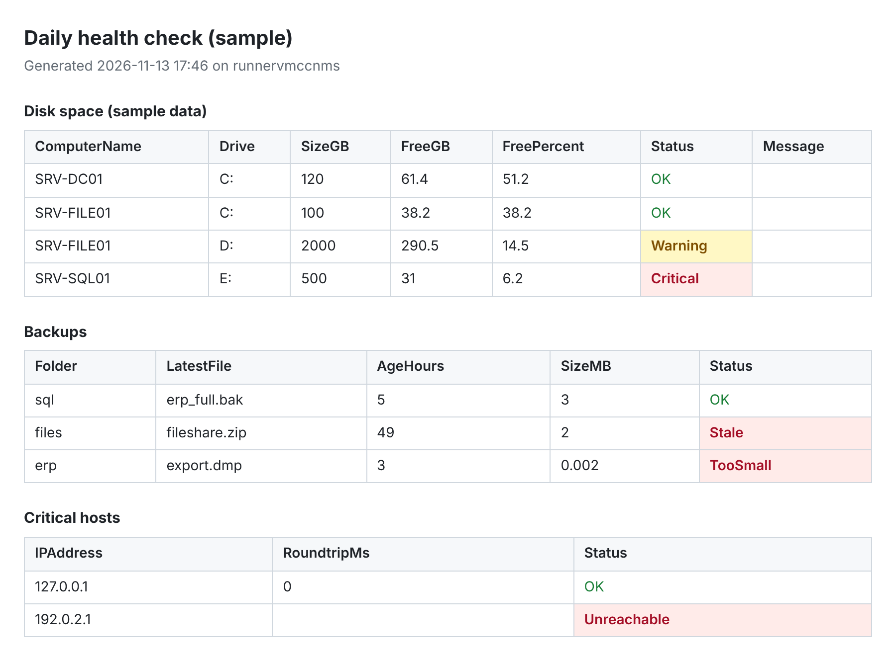

# it-automation-toolkit

[](https://github.com/taharabs/it-automation-toolkit/actions/workflows/ci.yml)


**The routine jobs of a Windows administrator, written as safe, tested PowerShell.**

A PowerShell module for the work that comes back every week: creating accounts for new staff, closing the accounts of people who leave, finding forgotten accounts, and checking each morning that disks, backups and key servers are healthy. Every command that changes Active Directory supports `-WhatIf`, and everything ends up in a readable HTML report.

| Command | What it does |
| --- | --- |
| `New-ADUserFromCsv` | Creates accounts from the HR spreadsheet: unique logon names, the right OU and groups per department, a random password to change at first logon |
| `Disable-DepartedADUser` | Offboarding: saves the user's groups to an audit file, disables the account, removes the groups, stamps the reason and moves it to a "disabled" OU |
| `Get-StaleADAccount` | Enabled users or computers that have not logged on for N days, or never did |
| `Get-DiskSpaceReport` | Free space on every fixed disk of a list of servers, OK / Warning / Critical |
| `Test-BackupFreshness` | Checks that every backup folder got a recent file, and that it is not suspiciously small |
| `Invoke-PingSweep` | Finds the hosts that answer on a subnet, pinging in parallel batches |
| `Export-ToolkitReport` | Turns the output of any command above into a self-contained HTML page, problems in red |

## Quick start

```powershell
git clone https://github.com/taharabs/it-automation-toolkit.git
Import-Module .\it-automation-toolkit\ITToolkit\ITToolkit.psd1

Get-Help New-ADUserFromCsv -Examples     # every command has help and examples
```

The Active Directory commands need the RSAT ActiveDirectory module and an account with the right delegation. The other commands only need PowerShell.

## Examples

**Onboarding: dry run first, then for real.**

```powershell
$ous    = @{ IT = 'OU=IT,OU=Staff,DC=contoso,DC=local'; Sales = 'OU=Sales,OU=Staff,DC=contoso,DC=local' }
$groups = @{ IT = 'GG-IT', 'GG-VPN'; Sales = 'GG-Sales' }

New-ADUserFromCsv -Path .\new-hires.csv -UpnSuffix contoso.local `
    -DefaultOU 'OU=Staff,DC=contoso,DC=local' -OUMap $ous -GroupMap $groups -WhatIf
```

```text
Line Name             SamAccountName OU                                  Groups        Status
---- ----             -------------- --                                  ------        ------
   2 Yacine Haddad    yhaddad        OU=IT,OU=Staff,DC=contoso,DC=local  GG-IT; GG-VPN WouldCreate
   3 Amina Belkacem   abelkacem      OU=Sales,OU=Staff,DC=contoso,DC=lo… GG-Sales      WouldCreate
```

Remove `-WhatIf` to create the accounts. Names are cleaned (accents, hyphens, apostrophes) and made unique: if `yhaddad` exists, the next one is `yhaddad2`. A row that fails is reported and the rest of the file is still processed.

**Offboarding a list of leavers, with an audit trail.**

```powershell
Import-Csv .\leavers.csv |
    Disable-DepartedADUser -DisabledOU 'OU=Disabled,DC=contoso,DC=local' -AuditPath .\offboarding-audit.csv -Reason 'Contract ended'
```

Groups are written to the audit file before they are removed, so access can be restored exactly. Accounts are disabled, never deleted. You are asked to confirm each account unless you add `-Confirm:$false`.

**A morning check in one line per area.**

```powershell
Get-DiskSpaceReport -ComputerName SRV-DC01, SRV-FILE01 | Where-Object Status -ne 'OK'
Test-BackupFreshness -Path '\\NAS01\backup\sql' -Filter '*.bak' -MaxAgeHours 26 -MinSizeMB 50
Invoke-PingSweep -Cidr 192.168.10.0/24 -ResolveNames
Get-StaleADAccount -Type Computer -Days 90 | Export-ToolkitReport -Path .\stale-computers.html -Title 'Stale computers'
```

## Scheduled daily report

[`examples/Daily-HealthCheck.ps1`](examples/Daily-HealthCheck.ps1) runs the disk, backup and host checks from a settings file and writes one HTML page per day. Its exit code (0 OK, 1 warning, 2 critical) lets Task Scheduler, PRTG or Zabbix raise an alert.

```powershell
.\examples\Daily-HealthCheck.ps1 -ConfigPath C:\Scripts\healthcheck.psd1
```



The sample above is produced by CI on every push ([`tools/New-SampleReport.ps1`](tools/New-SampleReport.ps1)). The backup and ping results are real; disk rows are sample data, since disk queries need Windows servers.

## Safety by design

- **Dry runs.** `New-ADUserFromCsv` and `Disable-DepartedADUser` support `-WhatIf` and report what they would do, row by row.
- **Confirmation.** Offboarding has `ConfirmImpact = High`: PowerShell asks before each account.
- **No passwords in files.** Initial passwords come from a cryptographic random generator, are handed to Active Directory as a `SecureString`, appear once in the output and must be changed at first logon.
- **Audit before change.** Group memberships are saved before they are removed.
- **One bad row never stops a batch.** Each row or server gets its own status: `Created`, `Failed`, `Unreachable`, and so on.
- **Clear failures.** Missing RSAT tools produce a plain message, not a stack trace.

## Tests

```powershell
./build.ps1      # installs Pester 5 if needed, then runs every test
```

The tests mock Active Directory and CIM, so they run anywhere, without a domain. CI runs them on **Windows PowerShell 5.1**, **PowerShell 7 on Windows** and **PowerShell 7 on Linux**, and lints every script with PSScriptAnalyzer (including a syntax check against both 5.1 and 7).

## Project layout

```text
ITToolkit/
  ITToolkit.psd1         module manifest
  Public/                one file per exported command
  Private/               helpers: naming, passwords, IP ranges, parallel ping
tests/                   Pester 5 tests and stand-ins for AD and CIM
examples/                daily health check, onboarding script, sample config and CSV
tools/                   builds the sample report shown above
```

## Roadmap

- [ ] `Get-ExpiringCertificate`: certificates that expire within N days on a list of servers
- [ ] `Get-ServiceHealth`: stopped automatic services across servers
- [ ] Send the daily report by e-mail through Microsoft Graph
- [ ] Publish the module to the PowerShell Gallery

## About the data

All names, domains and servers in this repository (contoso.local, SRV-FILE01, the people in the sample CSV) are fictional.

## License

MIT. Built by [Mohamed Tahar Ababsa](https://github.com/taharabs).
